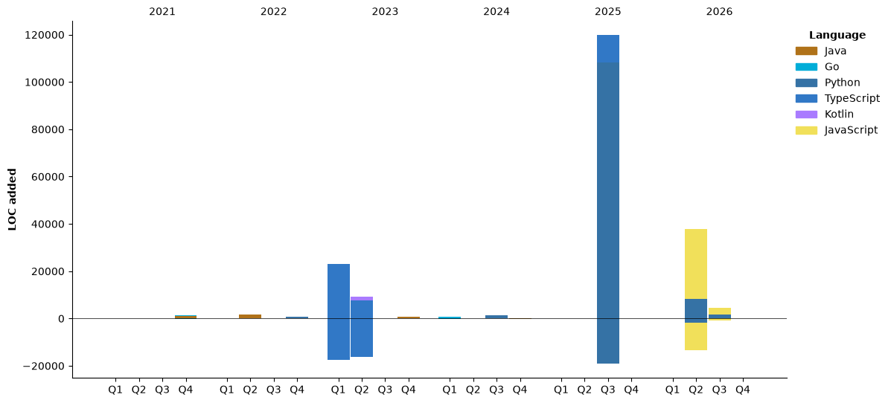

### Hi there 👋

- ✏️ Read my blog on https://chaofan.xyz
- 📫 How to reach me: chaofanxy@outlook.com


### Languages and Tools


### Language (last week)
<!--START_SECTION:waka-->


**🐱 My GitHub Data** 

> 📦 20.6 kB Used in GitHub's Storage 
 > 
> 🏆 17 Contributions in the Year 2026
 > 
> 🚫 Not Opted to Hire
 > 
> 📜 19 Public Repositories 
 > 
> 🔑 7 Private Repositories 
 > 
**I'm a Night 🦉** 

```text
🌞 Morning                28 commits          ⣿⣿⣀⣀⣀⣀⣀⣀⣀⣀⣀⣀⣀⣀⣀⣀⣀⣀⣀⣀⣀⣀⣀⣀⣀   08.59 % 
🌆 Daytime                69 commits          ⣿⣿⣿⣿⣿⣀⣀⣀⣀⣀⣀⣀⣀⣀⣀⣀⣀⣀⣀⣀⣀⣀⣀⣀⣀   21.17 % 
🌃 Evening                124 commits         ⣿⣿⣿⣿⣿⣿⣿⣿⣿⣿⣀⣀⣀⣀⣀⣀⣀⣀⣀⣀⣀⣀⣀⣀⣀   38.04 % 
🌙 Night                  105 commits         ⣿⣿⣿⣿⣿⣿⣿⣿⣀⣀⣀⣀⣀⣀⣀⣀⣀⣀⣀⣀⣀⣀⣀⣀⣀   32.21 % 
```
📅 **I'm Most Productive on Saturday** 

```text
Monday                   8 commits           ⣿⣀⣀⣀⣀⣀⣀⣀⣀⣀⣀⣀⣀⣀⣀⣀⣀⣀⣀⣀⣀⣀⣀⣀⣀   02.45 % 
Tuesday                  18 commits          ⣿⣀⣀⣀⣀⣀⣀⣀⣀⣀⣀⣀⣀⣀⣀⣀⣀⣀⣀⣀⣀⣀⣀⣀⣀   05.52 % 
Wednesday                11 commits          ⣿⣀⣀⣀⣀⣀⣀⣀⣀⣀⣀⣀⣀⣀⣀⣀⣀⣀⣀⣀⣀⣀⣀⣀⣀   03.37 % 
Thursday                 22 commits          ⣿⣿⣀⣀⣀⣀⣀⣀⣀⣀⣀⣀⣀⣀⣀⣀⣀⣀⣀⣀⣀⣀⣀⣀⣀   06.75 % 
Friday                   73 commits          ⣿⣿⣿⣿⣿⣿⣀⣀⣀⣀⣀⣀⣀⣀⣀⣀⣀⣀⣀⣀⣀⣀⣀⣀⣀   22.39 % 
Saturday                 134 commits         ⣿⣿⣿⣿⣿⣿⣿⣿⣿⣿⣀⣀⣀⣀⣀⣀⣀⣀⣀⣀⣀⣀⣀⣀⣀   41.10 % 
Sunday                   60 commits          ⣿⣿⣿⣿⣿⣀⣀⣀⣀⣀⣀⣀⣀⣀⣀⣀⣀⣀⣀⣀⣀⣀⣀⣀⣀   18.40 % 
```


📊 **This Week I Spent My Time On** 

```text
💬 Programming Languages: 
Java                     5 hrs 40 mins       ⣿⣿⣿⣿⣿⣿⣿⣿⣿⣿⣿⣿⣿⣿⣿⣿⣿⣿⣿⣿⣀⣀⣀⣀⣀   78.78 % 
Other                    31 mins             ⣿⣿⣀⣀⣀⣀⣀⣀⣀⣀⣀⣀⣀⣀⣀⣀⣀⣀⣀⣀⣀⣀⣀⣀⣀   07.20 % 
Baiji Spec               28 mins             ⣿⣿⣀⣀⣀⣀⣀⣀⣀⣀⣀⣀⣀⣀⣀⣀⣀⣀⣀⣀⣀⣀⣀⣀⣀   06.66 % 
JSON                     15 mins             ⣿⣀⣀⣀⣀⣀⣀⣀⣀⣀⣀⣀⣀⣀⣀⣀⣀⣀⣀⣀⣀⣀⣀⣀⣀   03.68 % 
XML                      14 mins             ⣿⣀⣀⣀⣀⣀⣀⣀⣀⣀⣀⣀⣀⣀⣀⣀⣀⣀⣀⣀⣀⣀⣀⣀⣀   03.33 % 

🔥 Editors: 
IntelliJ IDEA            6 hrs 10 mins       ⣿⣿⣿⣿⣿⣿⣿⣿⣿⣿⣿⣿⣿⣿⣿⣿⣿⣿⣿⣿⣿⣀⣀⣀⣀   85.55 % 
Claude Code              28 mins             ⣿⣿⣀⣀⣀⣀⣀⣀⣀⣀⣀⣀⣀⣀⣀⣀⣀⣀⣀⣀⣀⣀⣀⣀⣀   06.58 % 
Copilot CLI              25 mins             ⣿⣀⣀⣀⣀⣀⣀⣀⣀⣀⣀⣀⣀⣀⣀⣀⣀⣀⣀⣀⣀⣀⣀⣀⣀   05.97 % 
Codex Vscode             8 mins              ⣀⣀⣀⣀⣀⣀⣀⣀⣀⣀⣀⣀⣀⣀⣀⣀⣀⣀⣀⣀⣀⣀⣀⣀⣀   01.87 % 
Codex CLI                0 secs              ⣀⣀⣀⣀⣀⣀⣀⣀⣀⣀⣀⣀⣀⣀⣀⣀⣀⣀⣀⣀⣀⣀⣀⣀⣀   00.04 % 

💻 Operating System: 
Mac                      7 hrs 12 mins       ⣿⣿⣿⣿⣿⣿⣿⣿⣿⣿⣿⣿⣿⣿⣿⣿⣿⣿⣿⣿⣿⣿⣿⣿⣿   100.00 % 
```

🤖 **AI Coding This Week** 

```text
⏱ AI Coding Time: 1 hr 26 mins (20.06%)

✍️ 6 lines written by AI, 587 lines written by hand (1.01% AI-written)

🔤 2,144,093 Input Tokens, 56,795 Output Tokens

💵 $23.19 Estimated AI Cost This Week

🧠 16 AI Sessions, 24 AI Prompts

Code                     6 lines             ⣿⣿⣿⣿⣿⣿⣿⣿⣿⣿⣿⣿⣿⣿⣿⣿⣿⣿⣿⣿⣿⣿⣿⣿⣿   100.00 % 
GPT                      0 lines             ⣀⣀⣀⣀⣀⣀⣀⣀⣀⣀⣀⣀⣀⣀⣀⣀⣀⣀⣀⣀⣀⣀⣀⣀⣀   00.00 % 
Opus                     0 lines             ⣀⣀⣀⣀⣀⣀⣀⣀⣀⣀⣀⣀⣀⣀⣀⣀⣀⣀⣀⣀⣀⣀⣀⣀⣀   00.00 % 
Fable                    0 lines             ⣀⣀⣀⣀⣀⣀⣀⣀⣀⣀⣀⣀⣀⣀⣀⣀⣀⣀⣀⣀⣀⣀⣀⣀⣀   00.00 % 
K                        0 lines             ⣀⣀⣀⣀⣀⣀⣀⣀⣀⣀⣀⣀⣀⣀⣀⣀⣀⣀⣀⣀⣀⣀⣀⣀⣀   00.00 % 

🔎 AI Coding Insights:
🧑‍💻 Mostly Hands-On — 1.01% of written lines came from AI
📄 Detailed Prompter — average 584 characters per prompt
🔁 Iterative Prompter — average 2 prompts per session
🔍 Hands-On Reviewer — 99.11% of changed lines were hand-edited
```

**I Mostly Code in Python** 

```text
Python                   4 repos             ⣿⣿⣿⣿⣿⣿⣀⣀⣀⣀⣀⣀⣀⣀⣀⣀⣀⣀⣀⣀⣀⣀⣀⣀⣀   23.53 % 
TypeScript               4 repos             ⣿⣿⣿⣿⣿⣿⣀⣀⣀⣀⣀⣀⣀⣀⣀⣀⣀⣀⣀⣀⣀⣀⣀⣀⣀   23.53 % 
Go                       2 repos             ⣿⣿⣿⣀⣀⣀⣀⣀⣀⣀⣀⣀⣀⣀⣀⣀⣀⣀⣀⣀⣀⣀⣀⣀⣀   11.76 % 
JavaScript               1 repo              ⣿⣀⣀⣀⣀⣀⣀⣀⣀⣀⣀⣀⣀⣀⣀⣀⣀⣀⣀⣀⣀⣀⣀⣀⣀   05.88 % 
C++                      1 repo              ⣿⣀⣀⣀⣀⣀⣀⣀⣀⣀⣀⣀⣀⣀⣀⣀⣀⣀⣀⣀⣀⣀⣀⣀⣀   05.88 % 
```


**Timeline**




 Last Updated on 26/11/2026 08:18:11 UTC
<!--END_SECTION:waka-->

### Recent articles
<!-- BLOG-POST-LIST:START -->
- [CountDownLatch和CyclicBarrier的区别](https://chaofan.xyz/posts/6f3f7f34/)
- [alertmanager通知时机](https://chaofan.xyz/posts/4a58f7b9/)
- [使用Prometheus监控应用指标](https://chaofan.xyz/posts/49b1cc7e/)
- [云原生可观测性之OpenTelemetry](https://chaofan.xyz/posts/29a4bd97/)
- [使用systemd管理服务](https://chaofan.xyz/posts/c670b61f/)
<!-- BLOG-POST-LIST:END -->

### Steam recent playtime leaderboard
 <!-- steam-box-recent start -->
 <!-- steam-box-recent end -->
